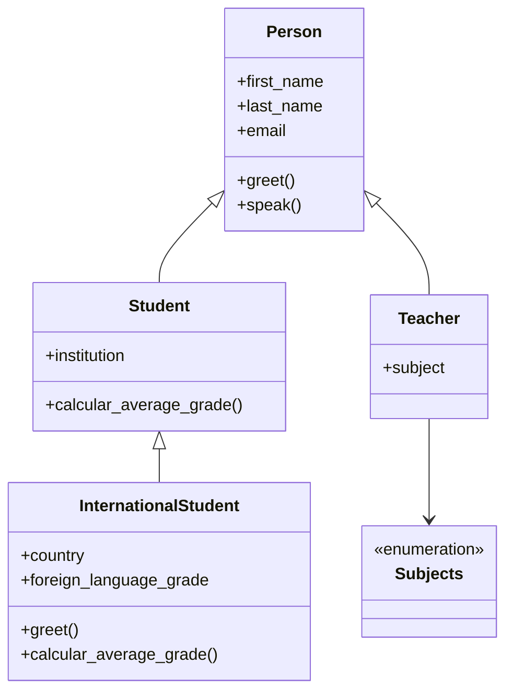
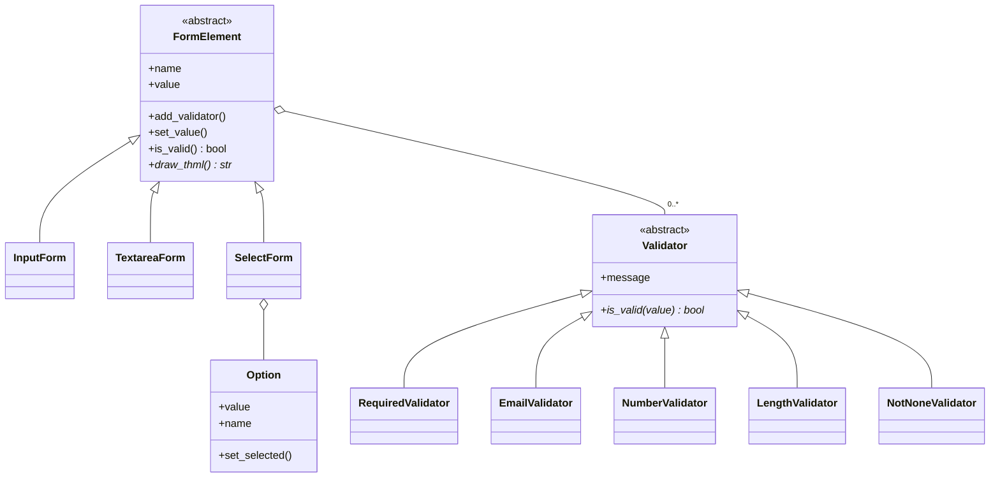
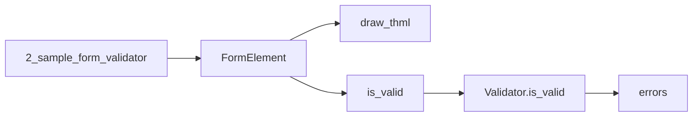

# Pytonic

Repositorio de práctica para reforzar Python con ejemplos progresivos, ejercicios y patrones de diseño. El contenido se va actualizando a medida que avanza el curso y se agregan nuevos temas.

## Objetivo

Repasar y consolidar fundamentos de Python con ejemplos cortos, ejercicios prácticos y casos de uso reales, sin depender solo de la memoria de proyectos anteriores.

## Requisitos

- Python 3.12+
- [uv](https://docs.astral.sh/uv/) para gestionar el entorno y las dependencias del proyecto

## Cómo empezar

```bash
# Clonar el repositorio
git clone <url-del-repo>
cd pytonic

# Crear y sincronizar el entorno virtual
uv sync

# Activar el entorno (Windows PowerShell)
.venv\Scripts\Activate.ps1

# Activar el entorno (Linux/macOS)
source .venv/bin/activate

# Ejecutar el script principal
uv run main.py
```

Para correr cualquier práctica:

```bash
uv run main.py
uv run practica_datetime.py
uv run practica_timestamp.py
uv run poo/1_car_sample.py
uv run poo/8_car_sample.py
uv run -m inheritance.sample.sample_inheritance
uv run -m abstract_class.form.1_sample_form_element
uv run -m abstract_class.form.2_sample_form_validator
uv run genericos/1-sample-generics-method.py
uv run genericos/1-sample-track-generics.py
uv run thread/bakery/sample-bakery.py
uv run thread/timer/sample_timer.py
uv run design_pattern/decorator/sample_decorator_coffee.py
uv run design_pattern/decorator/text_decorator.py
uv run design_pattern/factory/sample_factory.py
uv run design_pattern/singleton/singleton.py
uv run design_pattern/composite/sample-composite.py
uv run design_pattern/observer/sample-observer-1.py
uv run recursion/sample/sample-recursion.py
```

## Estructura del proyecto

```text
pytonic/
├── main.py                              # Punto de entrada básico
├── practica_datetime.py                 # Fechas y horas (datetime, locale)
├── practica_timestamp.py                # Timestamps (time / datetime)
├── dataclass/
│   └── person.py                       # Ejemplo de dataclass
├── poo/                                 # Programación orientada a objetos
│   ├── 1_car_sample.py
│   ├── 2_car_sample.py
│   ├── 3_car_sample.py
│   ├── 4_equal_sample.py
│   ├── 5-car_sample_dataclass.py
│   ├── 6_car_sample_enum.py
│   ├── 7_car_sample_enum.py
│   ├── 8_car_sample.py
│   ├── car.py, vehicle.py
│   ├── engine.py, fuel_tank.py, wheel.py, person.py
│   ├── color.py, car_type.py
│   └── constants.py
├── genericos/                           # Tipos y colecciones genéricas
│   ├── 1-sample-generics-method.py
│   ├── 1-sample-track-generics.py
│   ├── animal.py, car.py, customer.py, machinery.py, truck.py
│   └── ...
├── inheritance/                         # Herencia y polimorfismo
│   ├── models/
│   │   ├── person.py
│   │   ├── student.py
│   │   ├── teacher.py
│   │   ├── international_student.py
│   │   └── subjects.py
│   └── sample/
│       ├── sample_inheritance.py
│       ├── 2_sample_inheritance_constructor.py
│       └── 3_sample_inheritance_constructor.py
├── abstract_class/                      # Clases abstractas (ABC) y validación
│   ├── form/
│   │   ├── form_element.py
│   │   ├── input_form.py
│   │   ├── textarea_form.py
│   │   ├── select_form.py
│   │   ├── 1_sample_form_element.py
│   │   └── 2_sample_form_validator.py
│   └── validator/
│       ├── validator.py
│       ├── required_validator.py
│       ├── email_validator.py
│       ├── number_validator.py
│       ├── length_validator.py
│       └── not_none_validator.py
├── design_pattern/                      # Patrones de diseño
│   ├── decorator/
│   │   ├── sample_decorator_coffee.py
│   │   └── text_decorator.py
│   ├── factory/
│   │   ├── pizza_california_cheese.py
│   │   ├── pizza_california_veggie.py
│   │   ├── pizza_new_york_italian.py
│   │   ├── pizza_new_york_pepperoni.py
│   │   ├── pizza_new_york_veggie.py
│   │   ├── pizza_producto.py
│   │   ├── pizzeria_california_factory.py
│   │   ├── pizzeria_new_york_factory.py
│   │   ├── pizzeria_zone_abstract_factory.py
│   │   └── sample_factory.py
│   ├── composite/
│   │   └── sample-composite.py
│   ├── observer/
│   │   └── sample-observer-1.py
│   └── singleton/
│       └── singleton.py
├── recursion/                           # Recursión y árboles de componentes
│   ├── components.py
│   └── sample/
│       └── sample-recursion.py
├── thread/                             # Concurrencia con threading
│   ├── bakery/
│   ├── sample/
│   ├── timer/
│   ├── consumer.py
│   ├── functions.py
│   ├── imprimir_frases_task.py
│   └── name_thread.py
├── pyproject.toml
├── uv.lock
├── .python-version
└── README.md
```

## Patrones de diseño

### Decorator (`design_pattern/decorator/`)

El patrón `Decorator` permite agregar comportamiento a un objeto sin modificar su clase base. En este repositorio se muestra con:

- `Coffee` y `CoffeeDcorator` para sumar ingredientes y costos
- `Text` y `TextDecorator` para transformar cadenas con mayúsculas, inversión y reemplazo de espacios

Es útil cuando se quiere combinar responsabilidades dinámicamente, como condimentos de un café o transformaciones sobre texto.

### Factory (`design_pattern/factory/`)

El patrón `Factory` encapsula la creación de objetos dependiendo del tipo de producto o región. En este caso, `PizzeriaNewYorkFactory` y `PizzeriaCaliforniaFactory` instancian distintas pizzas y delegan la lógica de selección a una fábrica.

### Singleton (`design_pattern/singleton/`)

El patrón `Singleton` asegura que una clase tenga una sola instancia durante el ciclo de vida de la aplicación. El ejemplo `ConexionBD` simula un recurso compartido como una conexión a base de datos, evitando múltiples inicializaciones.

### Composite (`design_pattern/composite/`)

El patrón `Composite` permite tratar objetos individuales y grupos de objetos de manera uniforme. El ejemplo modela archivos y directorios: ambos implementan `Component`, y los directorios pueden contener otros componentes, mostrarlos recursivamente y buscar nombres dentro de su estructura.

### Observer (`design_pattern/observer/`)

El patrón `Observer` notifica a los suscriptores cuando cambia el estado de un objeto. En el ejemplo, los inversores se suscriben a distintas empresas y reciben una notificación cuando cambia su cotización; si el precio no cambia, no se envía ninguna actualización.

## Recursión (`recursion/`)

Los ejemplos de recursión recorren estructuras jerárquicas en profundidad. `Component` representa un nodo con hijos y `recursive_function` imprime el árbol recursivamente, mostrando cómo modelar una estructura de directorios, un producto o una composición de componentes.

## Arquitectura

### Herencia (`inheritance/`)

`Person` es la base. `Student` y `Teacher` la especializan; `InternationalStudent` extiende `Student` y sobrescribe `greet`, `calcular_average_grade` y `__str__`.



### Formularios y validadores (`abstract_class/`)

Dos ABCs separan responsabilidades. `FormElement` define el contrato de un campo (dibujar HTML y validar). `Validator` define la regla. Cada campo compone una lista de validadores y los recorre en `is_valid`.



Flujo de `2_sample_form_validator.py`: se arma el campo, se agregan validadores, se asigna el valor y `is_valid()` acumula los mensajes de error.



### Genéricos (`genericos/`)

Las prácticas usan `TypeVar`, `Generic` e `Iterable` para escribir funciones y contenedores que conservan el tipo de sus elementos. `from_array_to_list` convierte un iterable en una lista, y `Truck[T]` implementa un contenedor iterable con capacidad limitada para objetos como `Animal`, `Car` y `Machinery`.

### Concurrencia (`thread/`)

Los ejemplos exploran la creación de hilos mediante subclases de `Thread` y mediante `Thread(target=...)`, así como la consulta del hilo actual, el estado `is_alive()` y la espera con `join()`. También se muestra la sincronización de secciones críticas con `Lock` y el patrón productor-consumidor: `Baker` y `Consumer` comparten una `Bakery` que coordina la disponibilidad del pan con `Condition`. En `thread/timer/sample_timer.py`, `Timer` agenda ejecuciones repetidas de una tarea con un intervalo configurado.

## Temas cubiertos

| Tema | Estado | Archivos |
|------|--------|----------|
| Fechas y horas (`datetime`) | En curso | `practica_datetime.py` |
| Timestamps | En curso | `practica_timestamp.py` |
| POO — clases, `__init__`, atributos | En curso | `poo/1_car_sample.py` … `poo/4_equal_sample.py` |
| POO — dataclasses, constantes, enums | En curso | `poo/5-car_sample_dataclass.py` … `poo/7_car_sample_enum.py` |
| POO — composición (motor, tanque, ruedas) | En curso | `poo/8_car_sample.py` + modelos en `poo/` |
| Herencia y polimorfismo | En curso | `inheritance/` (`Person`, `Student`, `Teacher`, `InternationalStudent`) |
| `isinstance`, `cast`, tipado | En curso | `inheritance/sample/` |
| Clases abstractas (`abc.ABC`) | En curso | `abstract_class/form/form_element.py`, `abstract_class/validator/validator.py` |
| Formularios HTML (herencia + composición) | En curso | `abstract_class/form/` (`InputForm`, `TextareaForm`, `SelectForm`) |
| Validadores (estrategia sobre ABC) | En curso | `abstract_class/validator/` + `2_sample_form_validator.py` |
| Genéricos (`TypeVar`, `Generic`, `Iterable`) | En curso | `genericos/` |
| Concurrencia (`Thread`, tareas y `join`) | En curso | `thread/sample/`, `thread/name_thread.py` |
| Sincronización (`Lock`, `Condition`) | En curso | `thread/functions.py`, `thread/bakery/` |
| Temporizadores (`Timer`) | En curso | `thread/timer/sample_timer.py` |
| Patrones de diseño (`Decorator`, `Factory`, `Singleton`, `Composite`, `Observer`) | En curso | `design_pattern/` |
| Recursión sobre estructuras jerárquicas | En curso | `recursion/` |

> Esta tabla se actualiza conforme se agregan nuevos temas al repositorio.

## Convenciones

- Cada práctica suele ser un script independiente y fácil de ejecutar.
- Los temas más grandes se agrupan en paquetes (`poo/`, `inheritance/`, `abstract_class/`, `design_pattern/`, `thread/`).
- En `inheritance/` y `abstract_class/` se usan imports de paquete y conviene ejecutarlos con `uv run -m`.
- `FormElement` y `Validator` no se instancian: son clases abstractas. Las subclases implementan `draw_thml` e `is_valid`.
- Las tareas de `thread/` pueden ejecutarse concurrentemente; `join()` permite esperar a que terminen y `Lock`/`Condition` coordinan el acceso a recursos compartidos.
- Se prioriza un código claro y comentado para el aprendizaje, no para producción.

## Notas

Proyecto gestionado con **uv**. La versión de Python está fijada en `.python-version` (3.12). Los paquetes `inheritance` y `poo` están declarados en `pyproject.toml` para instalación editable. La carpeta `design_pattern` y `recursion` se ejecutan como scripts desde la raíz del proyecto (`uv run ...`).
